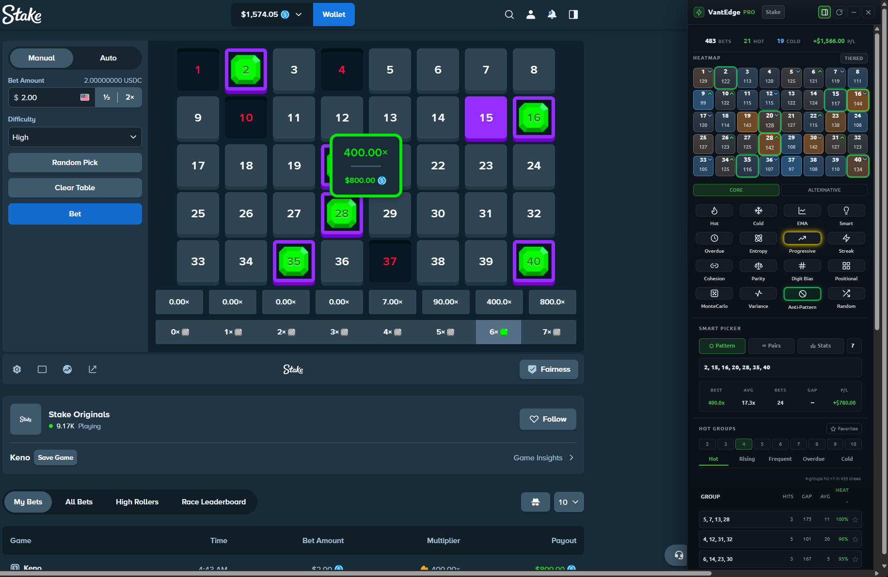
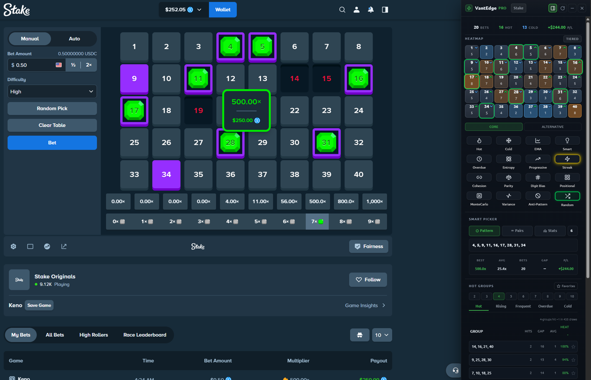
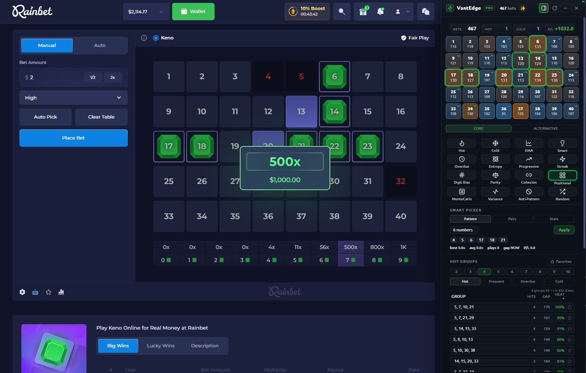
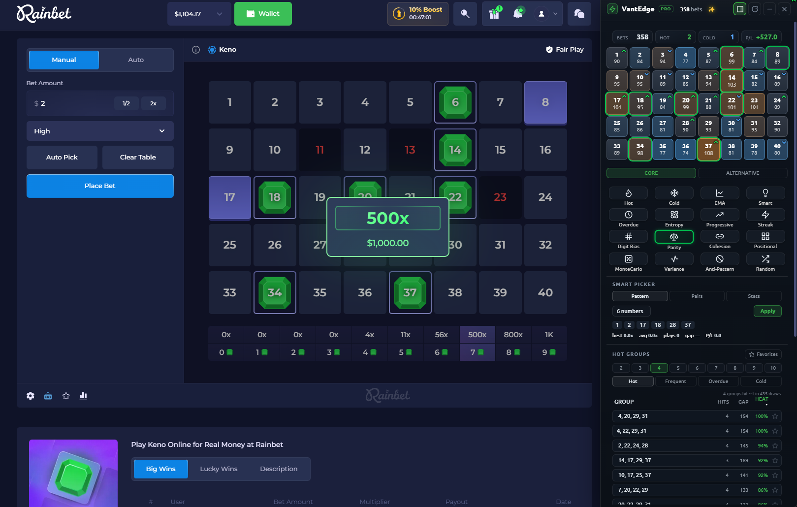

> [!NOTE]
> I've been building this tool for quite a while now - at first just for my own use - but eventually I realized the community might appreciate and benefit from something like this too, so I decided to make it public.
>
> Please keep in mind that these RNG-based casino games are *designed* to beat you over time, no matter what betting system you use.

<div align="center">

# 🎯 VantEdge

**A real‑time analytics sidebar for online Keno and Mines.**
It records every draw, builds a live heatmap, and runs 32 statistical strategies that surface patterns and pick your numbers - so your reads are driven by data, not gut feel.

[](#)
[](#)
[](#)
[](#license)



</div>

> [!WARNING]
> **Vantedge does not, and cannot, guarantee profit.** Keno is a negative‑expectation game. These strategies give you an *informational and analytical edge* - they detect and exploit RNG bias **only if a given site actually has one** - but no betting system beats a fair RNG over time. Treat this as an analytics tool, never a money machine. See the [full disclaimer](#-disclaimer--responsible-gambling).

---

## ✨ What it does

- **Live heatmap** - every drawn number is tracked per‑site; hot/cold numbers light up in real time, with a per‑number **Heat Score (0–100)**, momentum arrows, and a Tiered/Gradient colour toggle.
- **32 pick strategies** - 16 on the **Core** grid, 16 on **Alternative**, swapped in place by a toggle above the grid. Frequency, timing, spatial‑bias, statistical, correlation, and meta/blend models.
- **Ticket size control** - **Auto** gives each strategy its own size, or pin every strategy to 2–10 spots. Each tile shows how many numbers it will fill, so a click is never a surprise. This shapes variance, not expected return (see [note](#a-note-on-ticket-size)).
- **Hand‑off marks** - when a strategy doesn't have enough data and quietly falls back to another, the tile *says so* instead of passing off Hot's ticket as its own.
- **Payout ladder** - what your exact ticket pays at all four Stake risk levels, with RTP and standard deviation per row. The spread column is the point: risk changes the *shape* of the payout, not the edge.
- **Smart Picker** - three independent pickers (**Pattern**, **Pairs**, **Stats**) at any size 2–10, with live best/avg multiplier, bets, gap and P/L for the set on screen.
- **Hot Number Groups** - combinations of **2 to 10** numbers that recur together, in five views: **Hot, Rising, Frequent, Overdue, Cold**. Star any group to keep watching it.
- **Gap alerts** - a neutral notice when a combo you're invested in crosses 0.8× or 1.5× of its expected interval.
- **Real‑money P/L** - profit counted as `stake × (multiplier − 1)` in actual currency, not flat units, with ROI, wagered totals, and free ($0) bets excluded. One shared rule across overlay, popup, and worker.
- **Mines panel** - now in the sidebar alongside Keno: mine heatmap, per‑mine‑count tabs, safest / random‑safe pickers, clean‑cluster table, the full payout ladder, and your revealed‑tile history.
- **Significance‑gated models** - bias‑detection strategies use chi‑square / z‑score gates and fall back to plain frequency when no real signal is present, so you're not chasing noise.
- **Legend Stats** - automatically logs every big multiplier hit (≥30×) with the strategy that was active, so you can see what actually works on *your* sessions.
- **Local‑first & private** - all data lives in your browser (IndexedDB). No accounts, no telemetry. Optional GitHub Gist backup using **your own** token.
- **Adapts to the board** - auto‑detects classic 1–40 and Rainbet's Extreme 1–56 layouts; the Mines board is found by geometry, so non‑5×5 boards work too.

---

## 🎰 Supported sites

Stake (`.com / .us / .games / .bet`) · Rainbet · Roobet · Shuffle · BetFury · Winna · AceBet

> The panel activates on each site's **Keno** and **Mines** pages, and mounts on SPA navigation (no reload needed).

---

## 📸 Screenshots

<table>
<tr>
<td width="50%"><a href="docs/screenshots/stake1.png"></a></td>
<td width="50%"><a href="docs/screenshots/stake2.png"></a></td>
</tr>
<tr>
<td><b>Stake</b> - a 400× hit at 483 bets. The sidebar is docked beside the board, not over it: status strip, heatmap, the Core strategy grid, Smart Picker and Hot Groups all in one column.</td>
<td><b>Stake</b> - a 500× hit only 20 bets in. Note the heatmap counts are still single digits; this is what the panel looks like before the timing strategies have enough data.</td>
</tr>
<tr>
<td width="50%"><a href="docs/screenshots/rainbet1.png"></a></td>
<td width="50%"><a href="docs/screenshots/rainbet2.png"></a></td>
</tr>
<tr>
<td><b>Rainbet</b> - the same panel on a different host. Statistics are tracked <i>per site</i>, so each casino keeps its own draw history, heatmap and P/L; nothing from one bleeds into another.</td>
<td><b>Rainbet</b> - heat and grouping at a glance. The heatmap tints each number by observed-vs-expected rate, and <b>Hot Groups</b> below ranks the 4-number combinations that keep landing together, by hits, gap and heat.</td>
</tr>
</table>

---

## 🚀 Install (from source)

Vantedge is an unpacked browser extension - `manifest.json` lives at the repo root.

**Chrome / Edge / Brave / Vivaldi**
1. Download or `git clone` this repo.
2. Go to `chrome://extensions` (or `edge://`, `brave://`, `vivaldi://`).
3. Toggle **Developer mode** (top‑right).
4. Click **Load unpacked** and select the project folder.
5. Open a supported Keno page - the panel appears. Toggle it any time with **Ctrl/Cmd + Shift + K**.

**Firefox** (109+)
1. Go to `about:debugging` → **This Firefox** → **Load Temporary Add‑on…**
2. Select the `manifest.json` file. (Temporary add‑ons clear on restart.)

---

## 🕹️ Usage

1. Open Keno on a supported site. Vantedge docks as a **sidebar** on the right and reserves space so it sits *beside* the board rather than over it. Prefer a floating window? Hit the **layout** button in the header to switch to overlay mode - it remembers your choice and its position.
2. Play a few rounds - strategies sharpen with data. Row 1 of the Core grid is live from ~10 games; the rest come online around 20–30. Tiles that aren't ready yet say which strategy they're borrowing from.
3. Click any strategy tile to pick its numbers. Use the **Core / Alternative** toggle above the grid to swap in the other 16 models, and the **spots** control to leave sizing on **Auto** or pin every strategy to a fixed 2–10.
4. **Drag‑and‑drop** tiles to reorder either grid - Core and Alternative keep separate saved orders.
5. Scroll down the panel for the **payout ladder**, **Smart Picker**, **Hot Number Groups**, and **combo history**. Switch the header to **Mines** for that game's own heatmap and pickers.
6. Open the toolbar **popup** for the archival dashboard - Legend Stats, long‑range Mines statistics, backups, and Cloud Sync settings.

> On some sites (e.g. Winna) synthetic clicks are rejected, so Vantedge **highlights** the numbers for you to tap manually instead of auto‑clicking. In Mines it only ever *marks* tiles - revealing one is a real bet, so that click stays yours.

---

## 🧮 The payout ladder

Pick 1–10 numbers and the panel prints all four Stake pay tables for that exact ticket, plus two columns that matter more than the multipliers:

| Column | What it tells you |
| --- | --- |
| **RTP** | Expected return per unit staked, computed exactly (hypergeometric) from the pay row. |
| **SPREAD** | Standard deviation per unit staked - how violently that row swings. |

Every row is built to the same **~99% RTP** (Stake Originals run a 1% house edge, not the 3% often quoted). So switching risk **does not change your edge and cannot change your odds of hitting** - it changes the shape of the payout. On a 4‑pick, High drops the 1.7× that lands 21% of the time and pays 259× instead of 100× for the full hit: same expected return, roughly **2.4× the standard deviation**.

The tables were cross‑checked two ways before use - every row's hypergeometric EV lands in 98.65–99.07%, and all forty full‑hit cells match an independently sourced table. The panel hides itself on Rainbet's 56‑number Extreme mode, which pays differently.

---

## 📊 Dashboard (toolbar popup)

The in‑page sidebar carries the live analytics. The popup is the archival view:

### Keno
- **Number Occurrences** - per‑number hit counts at a glance.
- **Hot Number Groups** - combination analytics across the full stored history.
- **Legend Stats** - every ≥30× hit logged automatically, with totals, recent hits, and a breakdown of which strategy was active for each.

### Mines
- **Smart Heatmap** - board map flagging 🔴 hot spots, 🟢 safe zones, and ⭕ clusters.
- **Predictive Analytics** - the top safe positions to consider next.
- **Mine Count Analysis** - pick any mine count (1–24) to see games played, last played, and win rate for that setting.
- **Performance** - total games, win rate, net profit, ROI, plus current and longest win/loss streaks.
- **Pattern Analysis** - detected mine clusters, safe zones, and hot spots.

> Same caveat as Keno: Mines layouts are drawn fresh every round. The heatmap shows where mines *have* landed, which is not a guarantee of where they'll land next.

---

## 🧠 Strategy reference

All 32 strategies read the same per‑site draw history and return a ticket at the current spot count. The grids are ordered as a **testing path**, not a ranking - each row is a different *kind* of read, so walking the grid one tile at a time tries a new signal each click instead of re‑testing the same axis.

### Core grid

**Row 1 - Frequency.** Usable almost immediately (~10 games).

<table>
<thead><tr><th width="52"></th><th width="140">Strategy</th><th>Method</th><th>Idea</th></tr></thead>
<tbody>
<tr><td><picture><source media="(prefers-color-scheme: dark)" srcset="docs/icons/dark/hot.svg"></picture></td><td><b>Hot</b></td><td>Frequency</td><td>Most-drawn numbers across all recorded games</td></tr>
<tr><td><picture><source media="(prefers-color-scheme: dark)" srcset="docs/icons/dark/cold.svg"></picture></td><td><b>Cold</b></td><td>Inverse frequency</td><td>Least-drawn - mean-reversion</td></tr>
<tr><td><picture><source media="(prefers-color-scheme: dark)" srcset="docs/icons/dark/smart.svg"></picture></td><td><b>Smart</b></td><td>Dynamic percentile zoning</td><td>Top 25% / middle 50% / bottom 25% zones with randomized sampling</td></tr>
<tr><td><picture><source media="(prefers-color-scheme: dark)" srcset="docs/icons/dark/ema.svg"></picture></td><td><b>EMA</b></td><td>Exponential moving average</td><td>Recency-weighted frequency; alpha adapts 0.15–0.30 with recent volatility, so it turns faster than Hot when a session shifts</td></tr>
</tbody>
</table>

**Row 2 - Timing.** How numbers space themselves out (~20–30 games).

<table>
<thead><tr><th width="52"></th><th width="140">Strategy</th><th>Method</th><th>Idea</th></tr></thead>
<tbody>
<tr><td><picture><source media="(prefers-color-scheme: dark)" srcset="docs/icons/dark/overdue.svg"></picture></td><td><b>Overdue</b></td><td>Regression to mean</td><td><code>betsSince > 1.5× avgInterval</code></td></tr>
<tr><td><picture><source media="(prefers-color-scheme: dark)" srcset="docs/icons/dark/progressive.svg"></picture></td><td><b>Progressive</b></td><td>Momentum score</td><td><code>frequency / recency</code> - numbers heating up now</td></tr>
<tr><td><picture><source media="(prefers-color-scheme: dark)" srcset="docs/icons/dark/streak.svg"></picture></td><td><b>Streak</b></td><td>Consecutive detection</td><td>Back-to-back or near-consecutive hits</td></tr>
<tr><td><picture><source media="(prefers-color-scheme: dark)" srcset="docs/icons/dark/entropy.svg"></picture></td><td><b>Entropy</b></td><td>Consistency (CV)</td><td>The most clockwork numbers - lowest coefficient of variation in gaps</td></tr>
</tbody>
</table>

**Row 3 - Shape of the board.** Where numbers sit, not how often.

<table>
<thead><tr><th width="52"></th><th width="140">Strategy</th><th>Method</th><th>Idea</th></tr></thead>
<tbody>
<tr><td><picture><source media="(prefers-color-scheme: dark)" srcset="docs/icons/dark/positional.svg"></picture></td><td><b>Positional</b></td><td>Grid chi-square</td><td>Row/column bias on the 8×5 board (p&lt;0.05), measured over the whole session</td></tr>
<tr><td><picture><source media="(prefers-color-scheme: dark)" srcset="docs/icons/dark/sector.svg"></picture></td><td><b>Sector</b></td><td>Recent row/column bias</td><td>Scores rows and columns over the last ~60 draws, takes the two strongest, picks the most overdue numbers inside them - catches a bias Positional is too slow to see</td></tr>
<tr><td><picture><source media="(prefers-color-scheme: dark)" srcset="docs/icons/dark/digitbias.svg"></picture></td><td><b>Digit</b></td><td>Family z-score → gap</td><td>Groups by last digit, tests each family against its expected share, then picks the most overdue numbers inside the families that clear significance</td></tr>
<tr><td><picture><source media="(prefers-color-scheme: dark)" srcset="docs/icons/dark/coverage.svg"></picture></td><td><b>Coverage</b></td><td>Hot + max-spread</td><td>Hot numbers plus picks that maximise board spread</td></tr>
</tbody>
</table>

**Row 4 - Statistical treatments, then the control.**

<table>
<thead><tr><th width="52"></th><th width="140">Strategy</th><th>Method</th><th>Idea</th></tr></thead>
<tbody>
<tr><td><picture><source media="(prefers-color-scheme: dark)" srcset="docs/icons/dark/montecarlo.svg"></picture></td><td><b>Monte Carlo</b></td><td>200-sim weighted sampling</td><td>Simulates draws weighted by hit counts - Hot with deliberate jitter, so you don't play the identical ticket every round</td></tr>
<tr><td><picture><source media="(prefers-color-scheme: dark)" srcset="docs/icons/dark/variance.svg"></picture></td><td><b>Variance</b></td><td>Z-score deficit</td><td>How far each number sits <i>below</i> the 0.25/game expectation over the last ~120 draws - a recent drought, not an all-time cold streak</td></tr>
<tr><td><picture><source media="(prefers-color-scheme: dark)" srcset="docs/icons/dark/antipattern.svg"></picture></td><td><b>Anti-Pattern</b></td><td>Avoidance</td><td>Contrarian - deliberately avoids recently frequent combinations</td></tr>
<tr><td><picture><source media="(prefers-color-scheme: dark)" srcset="docs/icons/dark/random.svg"></picture></td><td><b>Random</b></td><td>Uniform</td><td>Pure random baseline - the control you're comparing everything against</td></tr>
</tbody>
</table>

### Alternative grid

The other sixteen, reachable through the **Alternative** toggle. Four of them (Repeat, Portfolio, Wheeling, Momentum) earned a Core slot on signal alone and only missed out because Core is full. Adaptive, Edge, Regime and Bayesian compose other strategies by design, so they are never marked as handing off. Drought, Realised and Hotzone need a specific condition before they say anything. The rest are contrarian reads that showed no measured signal, which for a contrarian is the strategy working rather than failing.

<table>
<thead><tr><th width="52"></th><th width="150">Strategy</th><th>Method</th><th>Idea</th></tr></thead>
<tbody>
<tr><td><picture><source media="(prefers-color-scheme: dark)" srcset="docs/icons/dark/repeat.svg"></picture></td><td><b>Repeat</b></td><td>Lag-1 autocorrelation</td><td>Given a number was drawn, how often it was drawn again in the very next game, against the 0.25 chance rate. The only strategy that reads draw <b>order</b></td></tr>
<tr><td><picture><source media="(prefers-color-scheme: dark)" srcset="docs/icons/dark/portfolio.svg"></picture></td><td><b>Portfolio</b></td><td>Sharpe-style heat/risk</td><td>Heat ÷ interval variance - strong heat <i>and</i> a steady pattern</td></tr>
<tr><td><picture><source media="(prefers-color-scheme: dark)" srcset="docs/icons/dark/wheeling.svg"></picture></td><td><b>Wheeling</b></td><td>Correlation expansion</td><td>Seeds from the hottest number, expands by co-occurrence partners</td></tr>
<tr><td><picture><source media="(prefers-color-scheme: dark)" srcset="docs/icons/dark/momentum.svg"></picture></td><td><b>Momentum</b></td><td>Recent-interval acceleration</td><td>Numbers arriving faster than their own long-run average</td></tr>
<tr><td><picture><source media="(prefers-color-scheme: dark)" srcset="docs/icons/dark/adaptive.svg"></picture></td><td><b>Adaptive</b></td><td>Session meta</td><td>Blends the top 2 AI-recommended strategies, weighted by recent win rate</td></tr>
<tr><td><picture><source media="(prefers-color-scheme: dark)" srcset="docs/icons/dark/edge.svg"></picture></td><td><b>Edge</b></td><td>Kelly-inspired meta</td><td>Scores each strategy by realised profit per unit staked this session, shrunk by how many rounds it has run, then blends the leaders</td></tr>
<tr><td><picture><source media="(prefers-color-scheme: dark)" srcset="docs/icons/dark/regime.svg"></picture></td><td><b>Regime</b></td><td>CUSUM change-point detection</td><td>Detects a shift into a hot or cold distributional regime and switches blends accordingly (40+ games)</td></tr>
<tr><td><picture><source media="(prefers-color-scheme: dark)" srcset="docs/icons/dark/bayesian.svg"></picture></td><td><b>Bayesian</b></td><td>Dynamic posterior</td><td>Per-number hit-probability posterior, updated after every draw</td></tr>
<tr><td><picture><source media="(prefers-color-scheme: dark)" srcset="docs/icons/dark/drought.svg"></picture></td><td><b>Drought</b></td><td>Rate vs its own pace</td><td>Numbers whose recent rate has fallen furthest below <b>their own</b> session pace - a number can run hot all session and still be in a personal drought</td></tr>
<tr><td><picture><source media="(prefers-color-scheme: dark)" srcset="docs/icons/dark/realised.svg"></picture></td><td><b>Realised</b></td><td>Return per unit staked</td><td>Reads your <b>bet</b> history, not the draws: what each number actually returned per unit staked, shrunk toward break-even. Needs 10+ paid bets</td></tr>
<tr><td><picture><source media="(prefers-color-scheme: dark)" srcset="docs/icons/dark/hotzone.svg"></picture></td><td><b>Hotzone</b></td><td>2-D block z-score → gap</td><td>Scans 2×2 and larger blocks for local bias (z &gt; 2.5), then picks the most overdue numbers inside them - hands back to Hot when nothing stands out</td></tr>
<tr><td><picture><source media="(prefers-color-scheme: dark)" srcset="docs/icons/dark/anticluster.svg"></picture></td><td><b>Anti-Cluster</b></td><td>Minimum co-occurrence</td><td>The mirror of Wheeling - builds a set of numbers that have <i>avoided</i> each other, spreading the ticket across independent draws</td></tr>
<tr><td><picture><source media="(prefers-color-scheme: dark)" srcset="docs/icons/dark/balanced.svg"></picture></td><td><b>Balanced</b></td><td>Zone coverage</td><td>Four equal zones, taking the numbers sitting closest to expected in each - the unremarkable ones, deliberately avoiding both tails</td></tr>
<tr><td><picture><source media="(prefers-color-scheme: dark)" srcset="docs/icons/dark/transition.svg"></picture></td><td><b>Transition</b></td><td>Cold-to-hot detection</td><td>Decreasing <code>betsSince</code> with increasing count - numbers emerging from a cold streak</td></tr>
<tr><td><picture><source media="(prefers-color-scheme: dark)" srcset="docs/icons/dark/volatility.svg"></picture></td><td><b>Volatility</b></td><td>Gap coefficient of variation</td><td>Numbers that arrive in bursts and lulls rather than at a steady pace - the exact mirror of Entropy</td></tr>
<tr><td><picture><source media="(prefers-color-scheme: dark)" srcset="docs/icons/dark/poisson.svg"></picture></td><td><b>Poisson</b></td><td>Survival probability</td><td>Models each gap as a Poisson process (λ = mean gap) and ranks by how improbable a gap this long would be. The most statistically grounded overdue read (30+ games)</td></tr>
</tbody>
</table>

### A note on ticket size

The **spots** control sets how many numbers a strategy fills - **Auto** gives each
strategy its own size, or pin every strategy to 2-10.

**It changes variance, not expected return.** Computed from the pay tables in this
repo, every spot count at every risk level returns **98.65-99.07%**. What changes is
the shape: a 3-pick on High wins once in 82 rounds (SD 8.9); a 3-pick on Classic
wins 59% of the time (SD 1.4). Same edge, thirty-fold difference in swing.

**The per-strategy Auto sizes are a labelling convention, not a measured edge.**
They were read off where each strategy's hit rate falls across its own ranking - but
that curve appears on a *provably fair* board too if the ranking window overlaps the
draw being scored (3,000 simulated fair games produce a 35%-to-17% curve out of
nothing). Distinguishing a real 5-point difference from noise here needs roughly
3,400 games per strategy. So Auto means "this strategy expresses a concentrated
read, so it fills fewer" - it does not earn anything.

> **Hand‑offs are visible.** Most strategies fall back to Hot or Smart while data is thin. Rather than pretend otherwise, Vantedge traces each strategy's internal calls and marks a tile when a clear majority of its ticket came from somewhere else - so clicking Poisson at 18 bets tells you it's really Hot's pick.

---

## 🏗️ How it works

```
Vantedge/
├── manifest.json        # MV3 config, host permissions, content scripts
├── injected.js          # Page‑context interceptor (XHR / Fetch / WebSocket) - reads game results
├── content.js           # Bridge between the page and the extension
├── overlay.js           # The sidebar UI, all 32 strategies, payout ladders, Smart Picker,
│                        #   Hot Groups, gap alerts and the Mines panel
├── money.js             # Shared P/L + currency rules for overlay, popup and worker
├── background.js        # Service worker: state, per‑strategy scoring, AI recommendation, storage
├── storage-manager.js   # IndexedDB layer + rolling auto‑backups
├── cloud-sync.js        # Optional GitHub Gist backup (per‑user token)
└── popup/               # Dashboard: Legend log, long‑range Mines stats, backups, Cloud Sync
```

`injected.js` watches the site's own network traffic to read each result the same way your browser does - it never injects bets or alters game state. Results flow to `background.js`, which maintains per‑site statistics and feeds `overlay.js`, where the strategies score and pick numbers.

**Profit is counted once, in one place.** `money.js` is loaded three ways (content script, service‑worker `importScripts`, popup `<script>`) so every surface agrees. The one rule worth remembering: profit on a bet is `stake × (multiplier − 1)`, never `payout − stake`. Free ($0) bets are excluded, currencies are kept separate with no conversion, and each is formatted at the precision the casinos themselves display.

Long sessions (1,500+ games) are handled without lagging the page - the heavier panels compute on demand rather than on every draw.

---

## ☁️ Cloud Sync (optional)

Back up your **Legend Stats** to a single **private** GitHub Gist, auto‑uploaded ~5s after any change.

1. Create a token with **only** the `gist` scope: [github.com/settings/tokens](https://github.com/settings/tokens/new?scopes=gist&description=Vantedge%20sync)
2. Open the extension popup → **Cloud Sync** → paste the token → **Save**.
3. Use **Push / Pull / Verify** as needed.

Your token is stored **only** in this browser's local extension storage and is never committed or transmitted anywhere except GitHub's API. Revoke it any time from the link above.

---

## 🔒 Data & privacy

- All gameplay data stays in your browser (IndexedDB, with `storage.local` fallback).
- No accounts, no analytics, no third‑party servers (Cloud Sync talks only to GitHub's API, with your token).
- Session history is capped (auto‑trimmed) and auto‑backed‑up locally.
- Export/import your stats as JSON any time from the popup.
- Renamed and retired strategies are aliased, so an old export keeps its Legend hits attributed to the right model instead of silently losing them.

---

## ⚠️ Disclaimer & responsible gambling

- **Educational / analytics tool.** Vantedge surfaces statistical patterns and automates number selection. It **does not guarantee winnings** and provides **no edge against a fair RNG**. Stake keno is provably fair; any real advantage exists only where a specific site's RNG is genuinely biased - which may not be the case, and may change at any time.
- **Overdue is not rare.** Gaps are geometric, so P(gap ≥ 1.5× expected) ≈ 22%. A combo at 94% of its expected gap has exactly the same chance next round as one that just landed. The draw has no memory - the gap alerts report where the gap sits and deliberately do not suggest acting on it.
- **Gambling is risky.** Keno has a house edge on every ticket. Never wager money you can't afford to lose.
- **Terms of Service.** Automating interactions with a casino site may violate its ToS and could put your account at risk. Vantedge reads results passively and clicks on your behalf; use it at your own risk.
- Provided **as‑is**, with no warranty. The authors are not liable for any losses.

---

## 🤝 Contributing

Issues and pull requests are welcome. If you're proposing a new strategy, please include its mathematical basis and which signal it reads from the draw history - and say what makes it a *different* read from the 32 already there, since several were retired for returning another strategy's ticket under a new name.

## License

MIT - see [`LICENSE`](LICENSE).
