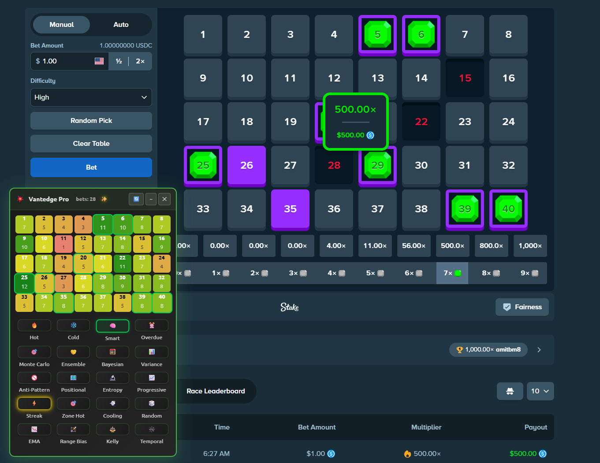
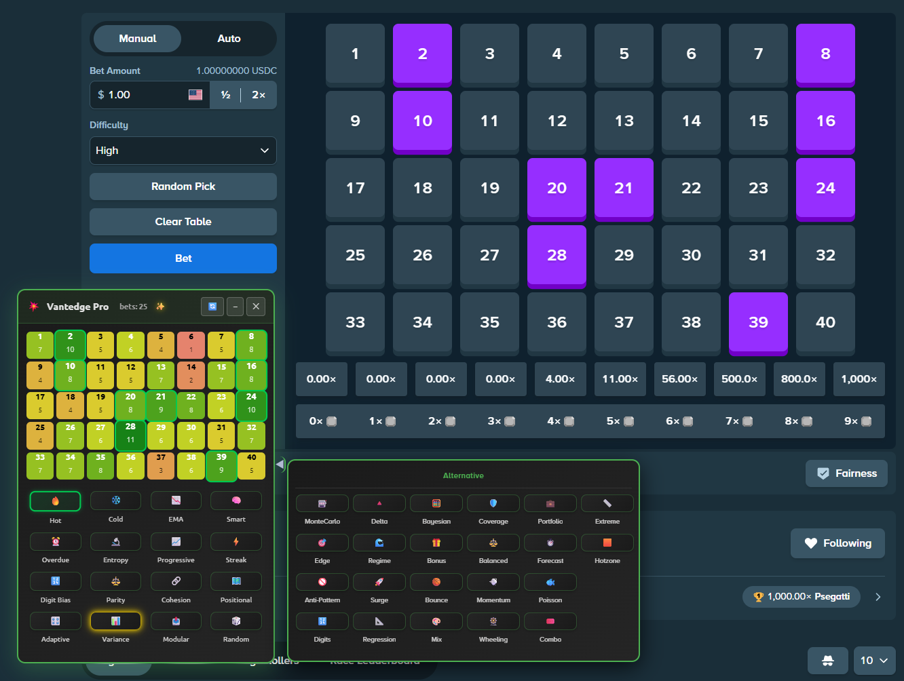
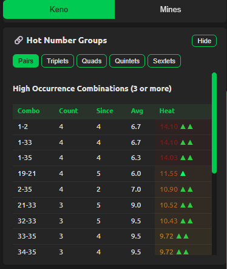

> [!NOTE]
I've been building this tool for quite a while now — at first just for my own use — but eventually I realized the community might appreciate and benefit from something like this too, so I decided to make it public.
>
> Please keep in mind that these RNG-based casino games are *designed* to beat you over time, no matter what betting system you use.

<div align="center">

# 🎯 VantEdge

**A real‑time analytics overlay & dashboard for online Keno — with a bonus Mines analytics mode.**
It records every draw, builds a live heatmap, and runs 38 statistical strategies that surface patterns and auto‑pick your numbers — so your reads are driven by data, not gut feel.

[](#)
[](#)
[](#)
[](#license)



</div>

> [!WARNING]
> **Vantedge does not, and cannot, guarantee profit.** Keno is a negative‑expectation game. These strategies give you an *informational and analytical edge* — they detect and exploit RNG bias **only if a given site actually has one** — but no betting system beats a fair RNG over time. Treat this as an analytics tool, never a money machine. See the [full disclaimer](#-disclaimer--responsible-gambling).

---

## ✨ What it does

- **Live heatmap** — every drawn number is tracked per‑site; hot/cold numbers light up in real time.
- **38 pick strategies** — frequency, recency, gap, spatial‑bias, statistical, and meta/blend models. One click highlights or auto‑selects 9 numbers.
- **Two‑panel UI** — a draggable main overlay plus a slide‑out **Alternative** drawer; drag‑and‑drop any strategy between them to build your own layout.
- **Significance‑gated models** — the bias‑detection strategies (Positional, Hotzone, Digit Bias, Parity, Modular, Variance) use chi‑square / z‑score gates and quietly fall back to plain frequency when no real signal is present, so you're not chasing noise.
- **Combination analytics** — the popup's **Hot Number Groups** surfaces the pairs → sextets that recur together (count, recency, and a heat score), not just hot singles.
- **Legend Stats** — automatically logs every big multiplier hit (≥30×) with the strategy that was active, so you can see what actually works on *your* sessions.
- **Mines mode** — a separate dashboard with a 5×5 smart heatmap (hot spots / safe zones / clusters), safe‑position predictions, and per‑mine‑count win‑rate / ROI / streak tracking.
- **Local‑first & private** — all data lives in your browser (IndexedDB). No accounts, no telemetry. Optional GitHub Gist backup using **your own** token.
- **Adapts to the board** — auto‑detects classic 1–40 and Rainbet's Extreme 1–56 layouts.

---

## 🎰 Supported sites

Stake (`.com / .us / .games / .bet`) · Rainbet · Roobet · Shuffle · BetFury · Winna · AceBet

> The overlay activates on each site's **Keno** pages; the toolbar popup also tracks **Mines** on supported sites (see the [Dashboard](#-dashboard-toolbar-popup) section).

---

## 📸 Screenshots

<p align="center">
  <a href="docs/screenshots/overlay.png"></a>
  &nbsp;
  <a href="docs/screenshots/alternative-drawer.png"></a>
  &nbsp;
  <a href="docs/screenshots/popup-stats.png"></a>
</p>
<p align="center"><sub><i>Overlay &amp; heatmap · Alternative drawer · Dashboard (Hot Number Groups, Legend, Mines)</i></sub></p>


---

## 🚀 Install (from source)

Vantedge is an unpacked browser extension — `manifest.json` lives at the repo root.

**Chrome / Edge / Brave / Vivaldi**
1. Download or `git clone` this repo.
2. Go to `chrome://extensions` (or `edge://`, `brave://`, `vivaldi://`).
3. Toggle **Developer mode** (top‑right).
4. Click **Load unpacked** and select the project folder.
5. Open a supported Keno page — the overlay appears. Toggle it any time with **Ctrl/Cmd + Shift + K**.

**Firefox** (109+)
1. Go to `about:debugging` → **This Firefox** → **Load Temporary Add‑on…**
2. Select the `manifest.json` file. (Temporary add‑ons clear on restart.)

---

## 🕹️ Usage

1. Open Keno on a supported site. The **Vantedge Pro** overlay docks on the page (drag the header to move it; it remembers its position).
2. Play a few rounds — strategies sharpen with data (most need ~20–50 games; the heatmap is meaningful after ~30).
3. Click any strategy tile to highlight/auto‑pick its 9 numbers. The **◀ tab** on the overlay's edge opens the **Alternative** drawer with the rest of the models.
4. **Drag‑and‑drop** tiles between the main grid and the drawer to curate which strategies sit up front.
5. Open the toolbar **popup** for the full dashboard — combination analytics, Legend Stats, the Mines mode, backups, and Cloud Sync settings (see below).

> On some sites (e.g. Winna) synthetic clicks are rejected, so Vantedge **highlights** the numbers for you to tap manually instead of auto‑clicking.

---

## 📊 Dashboard (toolbar popup)

Clicking the Vantedge toolbar icon opens the full analytics dashboard, with two tabs:

### Keno
- **Number Occurrences** — per‑number hit counts at a glance.
- **Hot Number Groups** — the combinations that actually recur together: **Pairs, Triplets, Quads, Quintets, and Sextets**, each ranked by **Count**, games **Since** last seen, **Avg** gap, and a **Heat** score. Surfaces "high‑occurrence combinations (3+)" so you can spot numbers that travel as a group, not just individually.
- **Legend Stats** — every ≥30× hit logged automatically, with totals, recent hits, and a breakdown of which strategy was active for each.

### Mines
A separate game mode with its own analytics (popup‑only — there's no in‑page overlay for Mines):
- **Smart Heatmap** — a 5×5 board map flagging 🔴 **Hot Spots** (where mines land often), 🟢 **Safe Zones**, and ⭕ **Clusters**.
- **Predictive Analytics** — the top safe positions to consider next.
- **Mine Count Analysis** — pick any mine count (1–24) to see games played, last played, and win rate for that setting.
- **Performance** — total games, win rate, net profit, ROI, plus current and longest win/loss streaks.
- **Pattern Analysis** — detected mine clusters, safe zones, and hot spots.

> Same caveat as Keno: Mines outcomes are RNG‑driven. The heatmap shows where mines *have* landed, which is not a guarantee of where they'll land next.

---

## 🧠 Strategy reference

Every strategy reads the same per‑site draw history and returns 9 numbers. They fall into a few families:

### Core
| Strategy | Method | Idea |
| --- | --- | --- |
| 🔥 Hot | Frequency | Most‑drawn numbers overall |
| ❄️ Cold | Inverse frequency | Least‑drawn (mean‑reversion) |
| 🚫 Anti‑Pattern | Avoidance | Contrarian — deliberately avoids recently frequent numbers |
| 🧠 Smart | Percentile zoning | Balanced coverage across hot/mid/cold zones |
| 🎲 Random | Fisher–Yates | Pure random baseline |

### Recency & momentum
| Strategy | Method | Idea |
| --- | --- | --- |
| 📉 EMA | Exp. moving average | Recency‑weighted frequency (recent games ~6× weight) |
| 📈 Progressive | Momentum score | `count / recency` — numbers heating up now |
| 🚀 Surge | Acceleration | Recent rate >> long‑run rate |
| 💨 Momentum | Interval acceleration | Appearing faster than its own average |
| ⚡ Streak | Consecutive | Back‑to‑back / near‑consecutive hits |
| 🏀 Bounce | Extreme reversion | Formerly hot, recently cold — due to rebound |
| ⏱️ Forecast | EMA on intervals | Predicts the next‑due appearance |

### Gap & overdue
| Strategy | Method | Idea |
| --- | --- | --- |
| ⏰ Overdue | Regression to mean | `betsSince > 1.5× avgInterval` |
| 🐟 Poisson | Survival probability | Models gaps as a Poisson process (most rigorous overdue) |
| 📏 Extreme | Z‑score gaps | Targets both extremes — very overdue **or** hot‑streaking |
| 📐 Regression | Linear trend | Negative‑slope interval trend (r² > 0.25 gate) |
| 🔺 Delta | Gap pattern | Most‑frequent delta pattern walked around the ring |

### Bias detection (statistically gated)
| Strategy | Method | Idea |
| --- | --- | --- |
| 📊 Variance | Chi‑square / z‑score | Significant deviations from expected frequency |
| 🗺️ Positional | Grid chi‑square | Row/column bias on the 8×5 board (p<0.05) |
| 🟧 Hotzone | 2‑D block density | Localized corner/center hotspots Positional dilutes |
| 🧭 Sector | Board‑region concentration | Plays the hottest quadrant‑sized sector + 1–2 spillover picks elsewhere |
| 🔢 Digit Bias | Last‑digit chi‑square | Numbers ending 0–9 drawn unevenly (df=9) |
| ⚖️ Parity | Even/odd z‑test | Persistent even/odd imbalance |
| 📤 Modular | Multi‑modulus chi‑square | Best of mod 4/5/8/10 groupings |
### Correlation
| Strategy | Method | Idea |
| --- | --- | --- |
| 🔗 Cohesion | Cluster travel | How well a number travels with the hot cluster |
| 🎡 Wheeling | Correlation expansion | Seed from hottest, expand by co‑occurrence |

### Meta & blends
| Strategy | Method | Idea |
| --- | --- | --- |
| 🎛️ Adaptive | Session meta | Blends the top‑recommended strategies by recent win rate |
| 🎯 Edge | Kelly‑inspired meta | Favors strategies that performed well recently |
| 🌊 Regime | Volatility detection | Adapts to chaotic vs stable sessions |
| 🧮 Bayesian | Posterior update | Per‑number hit‑probability posterior |
| 🎰 MonteCarlo | 200‑sim sampling | Most‑common numbers across simulated futures |

### Coverage & variance‑shaping *(reduce swings, don't change EV)*
| Strategy | Method | Idea |
| --- | --- | --- |
| 🛡️ Coverage | Hot + max‑spread | Hot numbers plus board spread |
| ⚖️ Balanced | Zone coverage | Proportional low/mid/high representation |
| 🎟️ Combo | Way‑ticket grouping | Overlapping subsets for more partial matches |
| 🎨 Mix | Hot + cold blend | Hedge across both ends |
| 💼 Portfolio | Sharpe‑style | Heat ÷ risk (interval variance) |
| 🎁 Bonus | Order‑probability | Recent **and** frequent — for order‑bonus variants |
| 🔬 Entropy | Consistency (CV) | Most clockwork, predictable intervals |

> Numbers like *"works from ~30 games"* are guidance — strategies degrade gracefully to Hot/Smart before they have enough data.

---

## 🏗️ How it works

```
Vantedge/
├── manifest.json        # MV3 config, host permissions, content scripts
├── injected.js          # Page‑context interceptor (XHR / Fetch / WebSocket) — reads game results
├── content.js           # Bridge between the page and the extension
├── overlay.js           # The overlay UI + all 38 strategies (number selection lives here)
├── background.js        # Service worker: state, per‑strategy scoring, AI recommendation, storage
├── storage-manager.js   # IndexedDB layer + rolling auto‑backups
├── cloud-sync.js        # Optional GitHub Gist backup (per‑user token)
└── popup/               # Dashboard: Keno analytics + Hot Number Groups, Legend log,
                         #   Mines heatmap/stats, backups, and Cloud Sync settings
```

`injected.js` watches the site's own network traffic to read each Keno result the same way your browser does — it never injects bets or alters game state. Results flow to `background.js`, which maintains per‑site statistics and feeds `overlay.js`, where the strategies score and pick numbers.

---

## ☁️ Cloud Sync (optional)

Back up your **Legend Stats** to a single **private** GitHub Gist, auto‑uploaded ~5s after any change.

1. Create a token with **only** the `gist` scope: [github.com/settings/tokens](https://github.com/settings/tokens/new?scopes=gist&description=Vantedge%20sync)
2. Open the extension popup → **Cloud Sync** → paste the token → **Save**.
3. Use **Push / Pull / Verify** as needed.

Your token is stored **only** in this browser's local extension storage and is never committed or transmitted anywhere except GitHub's API. Revoke it any time from the link above.

---

## 🔒 Data & privacy

- All gameplay data stays in your browser (IndexedDB, with `storage.local` fallback).
- No accounts, no analytics, no third‑party servers (Cloud Sync talks only to GitHub's API, with your token).
- Session history is capped (auto‑trimmed) and auto‑backed‑up locally.
- Export/import your stats as JSON any time from the popup.

---

## ⚠️ Disclaimer & responsible gambling

- **Educational / analytics tool.** Vantedge surfaces statistical patterns and automates number selection. It **does not guarantee winnings** and provides **no edge against a fair RNG**. Any real advantage exists only where a specific site's RNG is genuinely biased — which may not be the case, and may change at any time.
- **Gambling is risky.** Keno has a large house edge. Never wager money you can't afford to lose.
- **Terms of Service.** Automating interactions with a casino site may violate its ToS and could put your account at risk. Vantedge reads results passively and clicks on your behalf; use it at your own risk.
- Provided **as‑is**, with no warranty. The authors are not liable for any losses.

---

## 🤝 Contributing

Issues and pull requests are welcome. If you're proposing a new strategy, please include its mathematical basis and which signal it reads from the draw history. 

## License

MIT — see [`LICENSE`](LICENSE).
